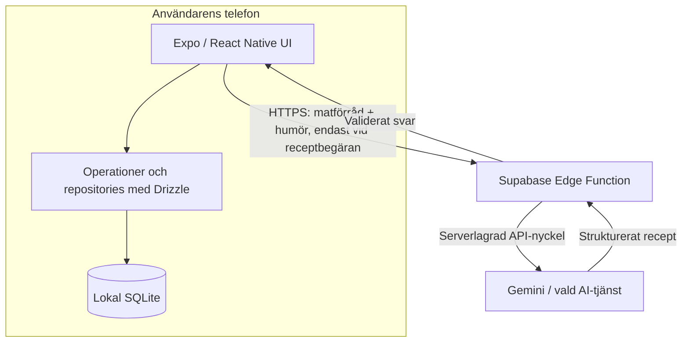

# I'm Hungry!

**Från råvaror till middag.** I'm Hungry! är en mobilapp som ska hjälpa hemmakockar att hålla koll på vad de har hemma och få AI-genererade receptförslag utifrån tillgängliga råvaror och mängder.

Projektet byggs av **BnL Studios** inom en Scrum-kurs. Det är under utveckling, inte en färdig app.

> **Aktuell arkitektur (2026-11-04):** React Native + Expo + TypeScript. Matförrådet lagras **lokalt på telefonen** med **SQLite och Drizzle ORM**. När användaren begär ett recept skickar appen bara råvaror, mängder och valt mat-humör till en **Supabase Edge Function**, som validerar begäran och anropar AI med en serverlagrad nyckel. **Supabase används inte som matförrådsdatabas.** Drizzle-schemat och migrationerna är implementerade; Edge Function och receptflödet är ännu inte byggda.

## Mål och MVP

Målgrupp: studenter och andra som ofta har råvaror hemma men svårt att bestämma vad de kan laga med just de mängderna.

| Ingår i MVP:n | Hur det ska fungera |
|---|---|
| Matförråd | Visa, lägga till, korrigera och ta bort råvaror med mängd och enhet. |
| Lokal lagring | Inventariet finns kvar efter omstart och kan hanteras utan internet. |
| Mat-humör | Välj t.ex. *Comfort food*, *Quick & easy* eller *Surprise me*. |
| Ett receptförslag | Skicka en begäran till Edge Function och visa ett AI-genererat recept utifrån råvarorna som finns. |
| Resultat och fel | Visa recepttitel, tid, ingredienser, mängder och steg, eller ett begripligt felmeddelande. |

Utanför MVP:n: användarkonton, molnsynkronisering, favoriter, recepthistorik, automatiska avdrag ur matförrådet, avancerade preferenser, inköpslistor och streckkodsskanning. **Inventariet fungerar offline; receptgenerering kräver internet.** Lokal data synkroniseras inte mellan enheter och kan förloras vid avinstallation.

Se [MVP](docs/mvp.md) och [Product Backlog](docs/USER_STORIES.md).

## Teknik och arkitektur

| Del | Val | Status |
|---|---|---|
| Mobilapp | React Native, Expo SDK 58, TypeScript och Expo Router | Implementerad i `mobile/` |
| Lokal databas | Expo SQLite | Implementerad |
| ORM och migrationer | Drizzle ORM + Drizzle Kit | Implementerade; två migrationer |
| Recept-gateway | Supabase Edge Functions (Deno/TypeScript) | Vald design, ännu inte byggd |
| AI-tjänst | Gemini Flash enligt beslut 03; möjlighet att byta leverantör | Integration inte byggd |
| CI | GitHub Actions för mobilapp | Kör typkontroll vid PR och push till `main` |
| Process | Scrum, trunk-based development, granskade PR:er, squash merge | Dokumenterat |



**Viktig säkerhetsgräns:** API-nyckeln lagras bara som hemlighet i Edge Function, aldrig i appen. Funktionens indata och AI-svar måste valideras. Utan användarinloggning behöver en publik Edge Function dessutom begränsa missbruk och kostnader (t.ex. rate limiting, kvoter och övervakning) innan den görs publikt tillgänglig. Klienten ska kontrollera receptets mängder mot sitt lokala inventarie; funktionens begäran är inte bevis för vad som faktiskt är lagrat på telefonen.

Läs [arkitekturen och dataintegritet](docs/arkitektur.md), [databasschemat](docs/databasschema.md) och [beslutsloggen](docs/beslutslogg.md).

## Kom igång

**Krav:** Git, Node.js och npm samt simulator/emulator eller mobil med stöd för Expo. Projektet har en `package-lock.json`, så använd `npm ci` för reproducerbar installation.

```bash
git clone https://github.com/BnL-Studios/im-hungry.git
cd im-hungry/mobile
npm ci
npx expo start
```

Välj i Expo-terminalen om du vill köra i simulator, emulator eller på en telefon. Beroende på vilka native-moduler som tillkommer kan en **development build** behövas. Se [Expo-dokumentationen](https://docs.expo.dev/get-started/start-developing/).

**Aktuellt läge:** Expo-appen finns under `mobile/`. Datalagret är på plats med Drizzle-schema, två migrationer och `CHECK`-begränsningar för mängd och enhet. Nästa steg är matförrådets skärmar (US-01–US-04); Edge Function och receptflödet återstår.

**Legacy:** Spring Boot-koden är borttagen. Ingen Java-server eller molndatabas behövs för matförrådet i målarkitekturen.

## Testning och CI

- Kör `npm ci` i `mobile/` för att installera enligt låsfilen.
- Kör `npx tsc --noEmit` från `mobile/` för typkontroll.
- Kör `npx expo-doctor` för att kontrollera beroenden och konfiguration.
- När testverktyg installerats: testa verksamhetslogik, SQLite CRUD och uppgradering av migrationer.
- [GitHub Actions-CI](.github/workflows/ci.yml) installerar beroenden, validerar Expo-konfigurationen och typkontrollerar appkällkoden vid PR och push till `main`. Tester läggs till när de implementeras.

**Branch protection:** Den gamla statuskontrollen **Backend (Java 21)** ersätts i CI med **Mobile (Node 22)**. Om `Backend (Java 21)` fortfarande är obligatorisk i GitHub måste en administratör byta till den nya kontrollen efter första gröna körningen. Detta sker inte automatiskt.

[GitHub Actions](https://github.com/BnL-Studios/im-hungry/actions) · [Git-arbetsflöde](docs/git-workflow.md)

## Projektstruktur

```text
im-hungry/
├── mobile/                     # Expo-mobilapp
│   ├── app.json
│   ├── package.json
│   ├── drizzle/                # Genererade SQL-migrationer
│   └── src/
│       ├── app/                # Routes (Expo Router)
│       ├── db/                 # Drizzle-klient, schema och provider
│       ├── features/inventory/ # Delat datalager för matförrådet
│       └── screens/            # Skärmkomponenter (AddIngredientScreen)
├── docs/
│   ├── arkitektur.md           # Lokal SQLite + Supabase Edge Function
│   ├── databasschema.md        # Databasschema (SQLite)
│   ├── databasschema.dbml      # Redigerbar DBML
│   ├── mvp.md
│   ├── USER_STORIES.md
│   ├── beslutslogg.md
│   ├── definition-of-done.md
│   ├── git-workflow.md
│   ├── gruppkontrakt.md
│   ├── sprintar/
│   └── reflektioner/
├── .github/
│   ├── workflows/ci.yml        # Mobil CI
│   ├── ISSUE_TEMPLATE/
│   └── pull_request_template.md
└── README.md
```

**Var kod hamnar:** `mobile/src/app/` innehåller endast routes; varje fil där blir en skärm. `mobile/src/db/` har Drizzle-klient, schema och databasprovider, och `mobile/drizzle/` de genererade migrationerna. `mobile/src/features/inventory/` har det delade datalagret för matförrådet, och `mobile/src/screens/` har skärmkomponenter som `AddIngredientScreen`. `supabase/functions/generate-recipe/` byggs när receptflödet startar.

## Team och arbetsflöde

| Namn | GitHub |
|---|---|
| Benjamin Simmons | [@SimmoM8](https://github.com/SimmoM8) |
| Leo Spenner | [@spennerr](https://github.com/spennerr) |

Vi använder kortlivade branches från `main`, pull requests, minst en annan persons godkännande, och **Squash and merge** som standard. Enligt [gruppkontraktet](docs/gruppkontrakt.md) granskar vi PR:er inom 24 timmar och mergar inte våra egna PR:er.

[GitHub Project-board](https://github.com/orgs/BnL-Studios/projects/1) · [Issues](https://github.com/BnL-Studios/im-hungry/issues) · [Pull requests](https://github.com/BnL-Studios/im-hungry/pulls)

## Dokumentation

| Dokument | Syfte |
|---|---|
| [MVP](docs/mvp.md) | Omfattning och avgränsningar |
| [Product Backlog](docs/USER_STORIES.md) | User stories och acceptanskriterier |
| [Arkitektur](docs/arkitektur.md) | Ansvar, dataflöden, AI-gateway och säkerhet |
| [Databasschema](docs/databasschema.md) · [DBML](docs/databasschema.dbml) | Lokal SQLite-modell |
| [Beslutslogg](docs/beslutslogg.md) | Tidigare och gällande teknikbeslut |
| [Git-arbetsflöde](docs/git-workflow.md) | Branches, PR, CI och squash merge |
| [Definition of Done](docs/definition-of-done.md) | Kvalitetskrav per story |
| [Gruppkontrakt](docs/gruppkontrakt.md) | Teamregler |
| [Sprintdokumentation](docs/sprintar/) | Planning, standup, review, retro |
| [Individuella reflektioner](docs/reflektioner/) | Kursreflektioner |
