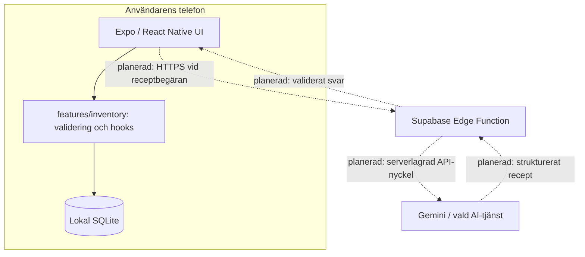

# I'm Hungry!

**Från råvaror till middag.** I'm Hungry! är en mobilapp som ska hjälpa hemmakockar att hålla koll på vad de har hemma och få AI-genererade receptförslag utifrån tillgängliga råvaror och mängder.

Projektet byggs av **BnL Studios** inom en Scrum-kurs. Det är under utveckling, inte en färdig app.

> **Aktuellt läge (2026-11-13, sprint 1):** Appen är en React Native-app med Expo och TypeScript. Matförrådet lagras **lokalt på telefonen** med **SQLite och Drizzle ORM**. Fliken **Råvaror** läser matförrådet från SQLite och man kan lägga till en råvara via en modal. Arbetet ligger på branchen `add-ingredient` och väntar på granskning/merge. **Supabase Edge Function, AI och receptflödet är ännu inte byggda.** Supabase används inte som matförrådsdatabas.

## Mål och MVP

Målgrupp: studenter och andra som ofta har råvaror hemma men svårt att bestämma vad de kan laga med just de mängderna.

| Ingår i MVP:n | Hur det ska fungera | Status i sprint 1 |
|---|---|---|
| Matförråd | Visa, lägga till, korrigera och ta bort råvaror med mängd och enhet. | Visa och lägga till är implementerat; korrigera/ta bort återstår (US-03/US-04). |
| Lokal lagring | Inventariet finns kvar efter omstart och kan hanteras utan internet. | Implementerat med Expo SQLite + Drizzle. |
| Mat-humör | Välj t.ex. *Comfort food*, *Quick & easy* eller *Surprise me*. | Inte påbörjat. |
| Ett receptförslag | Skicka en begäran till Edge Function och visa ett AI-genererat recept utifrån råvarorna som finns. | Inte påbörjat; Edge Function finns inte i repot. |
| Resultat och fel | Visa recepttitel, tid, ingredienser, mängder och steg, eller ett begripligt felmeddelande. | Inte påbörjat. |

Utanför MVP:n: användarkonton, molnsynkronisering, favoriter, recepthistorik, automatiska avdrag ur matförrådet, avancerade preferenser, inköpslistor och streckkodsskanning. **Inventariet fungerar offline; receptgenerering kräver internet.** Lokal data synkroniseras inte mellan enheter och kan förloras vid avinstallation.

Se [MVP](docs/mvp.md), [Product Backlog](docs/USER_STORIES.md) och [sprint 1](docs/sprintar/sprint-1/planning.md).

## Teknik och arkitektur

| Del | Val | Status |
|---|---|---|
| Mobilapp | React Native, Expo SDK 58, TypeScript och Expo Router | Implementerad i `mobile/` |
| Navigation | Två flikar: Home (placeholder) och Råvaror; `add-ingredient` som modal | Implementerad |
| Lokal databas | Expo SQLite | Implementerad |
| ORM och migrationer | Drizzle ORM + Drizzle Kit | Implementerade; två migrationer |
| Matförrådets UI | Lista från SQLite, formulär för ny råvara, validering och fel/empty-state | Implementerat på branchen `add-ingredient`; väntar review/merge |
| Recept-gateway | Supabase Edge Functions (Deno/TypeScript) | Vald design, ännu inte byggd |
| AI-tjänst | Gemini Flash enligt beslut 03; möjlighet att byta leverantör | Integration inte byggd |
| Test | Vitest: validering, enheter och riktiga SQL-migrationer | Implementerat; 3 testfiler |
| CI | GitHub Actions för mobilapp | `npm ci`, Expo-konfiguration, `tsc --noEmit` och `npm test` |
| Process | Scrum, trunk-based development, granskade PR:er, squash merge | Dokumenterat |



Heldragna pilar är implementerade i sprint 1; streckade pilar är målarkitektur som återstår.

**Viktig säkerhetsgräns:** När receptflödet byggs ska API-nyckeln bara ligga som hemlighet i Edge Function, aldrig i appen. Funktionens indata och AI-svar måste valideras. Utan användarinloggning behöver en publik Edge Function dessutom begränsa missbruk och kostnader (t.ex. rate limiting, kvoter och övervakning) innan den görs publikt tillgänglig. Klienten ska kontrollera receptets mängder mot sitt lokala inventarie; funktionens begäran är inte bevis för vad som faktiskt är lagrat på telefonen.

Läs [arkitekturen och dataintegritet](docs/arkitektur.md), [databasschemat](docs/databasschema.md) och [beslutsloggen](docs/beslutslogg.md).

## Kom igång

**Krav:** Git, Node.js 22 eller senare och npm samt simulator/emulator eller mobil med stöd för Expo. Projektet har en `package-lock.json`, så använd `npm ci` för reproducerbar installation. Migrationstestet använder `node:sqlite`, som kräver Node 22+.

```bash
git clone https://github.com/BnL-Studios/im-hungry.git
cd im-hungry/mobile
npm ci
npx expo start
```

Välj i Expo-terminalen om du vill köra i simulator, emulator eller på en telefon. Beroende på vilka native-moduler som tillkommer kan en **development build** behövas. Se [Expo-dokumentationen](https://docs.expo.dev/get-started/start-developing/).

## Testning och CI

Kör från `mobile/`:

```bash
npx tsc --noEmit       # typkontroll
npm test               # Vitest: validering, enheter och migrationer
npm run lint           # ESLint via expo lint
npx expo-doctor        # kontrollera beroenden och konfiguration
```

Testfilerna ligger i `mobile/src/features/inventory/`:

- `validation.test.ts` testar inmatningsreglerna.
- `units.test.ts` testar enheter och formatering.
- `migrations.test.ts` kör de riktiga SQL-migrationerna mot en temporär SQLite-databas och kontrollerar att `CHECK`-begränsningarna stoppar ogiltiga rader.

[GitHub Actions-CI](.github/workflows/ci.yml) installerar beroenden, validerar Expo-konfigurationen, typkontrollerar appkällkoden och kör `npm test` vid PR och push till `main`. Lint körs lokalt men ingår inte i CI-workflowen ännu.

**Branch protection:** CI-kontrollen heter **Mobile (Node 22)**. Om branch protection fortfarande kräver den gamla kontrollen **Backend (Java 21)** måste en GitHub-administratör byta till **Mobile (Node 22)** efter första gröna körningen. Detta sker inte automatiskt.

[GitHub Actions](https://github.com/BnL-Studios/im-hungry/actions) · [Git-arbetsflöde](docs/git-workflow.md)

## Aktuellt läge

Sprint 1 pågår (2026-11-09–2026-11-16). Det som är klart i koden:

- Flikarna Home och Råvaror.
- Råvarulistan läser från lokal SQLite via Drizzle och `useLiveQuery`.
- Formuläret **Lägg till råvara** validerar namn, mängd och enhet och sparar via det delade inventory-lagret.
- Två Drizzle-migrationer med `CHECK`-begränsningar för positiv mängd och tillåtna enheter.
- Vitest-tester för validering, enheter och migrationer.

Det som återstår:

- US-03 (korrigera mängd) och US-04 (ta bort råvara).
- Mat-humör, Supabase Edge Function, AI-integration och receptvy.
- Home-fliken är fortfarande Expos `Hello World`-placeholder.
- Granskning och merge av branchen `add-ingredient`.

**Legacy:** Spring Boot-koden är borttagen. Ingen Java-server eller molndatabas behövs för matförrådet i målarkitekturen.

## Projektstruktur

```text
im-hungry/
├── mobile/                          # Expo-mobilapp
│   ├── app.json
│   ├── package.json
│   ├── drizzle/                     # Genererade SQL-migrationer + metadata
│   ├── src/
│   │   ├── app/                     # Routes (Expo Router)
│   │   │   ├── _layout.tsx          # Rot-Stack + DatabaseProvider
│   │   │   ├── add-ingredient.tsx   # Modal route
│   │   │   └── (tabs)/
│   │   │       ├── _layout.tsx      # Home + Råvaror
│   │   │       ├── index.tsx        # Home (placeholder)
│   │   │       └── ingredients/
│   │   │           └── index.tsx    # Tunn route till IngredientsScreen
│   │   ├── screens/                 # Skärmkomponenter
│   │   │   ├── IngredientsScreen.tsx
│   │   │   └── AddIngredientScreen.tsx
│   │   ├── features/inventory/      # Enheter, validering, repository + tester
│   │   └── db/                      # Drizzle-schema, client, provider
│   └── ...
├── docs/
│   ├── arkitektur.md                # Lokal SQLite + planerad Edge Function
│   ├── databasschema.md             # Databasschema (SQLite)
│   ├── databasschema.dbml           # Redigerbar DBML
│   ├── mvp.md
│   ├── USER_STORIES.md
│   ├── beslutslogg.md
│   ├── definition-of-done.md
│   ├── git-workflow.md
│   ├── gruppkontrakt.md
│   ├── sprintar/
│   └── reflektioner/
├── .github/
│   ├── workflows/ci.yml
│   ├── ISSUE_TEMPLATE/
│   └── pull_request_template.md
└── README.md
```

**Var kod hamnar:** `mobile/src/app/` innehåller endast routes; varje fil där blir en skärm. `mobile/src/screens/` har skärmkomponenter, `mobile/src/features/` domän- och datalager, `mobile/src/db/` Drizzle-schema och databasprovider, och `mobile/drizzle/` de genererade migrationerna. `supabase/functions/generate-recipe/` byggs när receptflödet startar.

## Team och arbetsflöde

| Namn | GitHub |
|---|---|
| Benjamin Simmons | [@SimmoM8](https://github.com/SimmoM8) |
| Leo Spenner | [@spennerr](https://github.com/spennerr) |

Vi använder kortlivade branches från `main`, pull requests, minst en annan persons godkännande, och **Squash and merge** som standard. Enligt [gruppkontraktet](docs/gruppkontrakt.md) granskar vi PR:er inom 24 timmar och mergar inte våra egna PR:er.

[GitHub Project-board](https://github.com/orgs/BnL-Studios/projects/1) · [Issues](https://github.com/BnL-Studios/im-hungry/issues) · [Pull requests](https://github.com/BnL-Studios/im-hungry/pulls)

## Dokumentation

| Dokument | Syfte |
|---|---|
| [MVP](docs/mvp.md) | Omfattning och avgränsningar |
| [Product Backlog](docs/USER_STORIES.md) | User stories och acceptanskriterier |
| [Arkitektur](docs/arkitektur.md) | Ansvar, dataflöden, AI-gateway och säkerhet |
| [Databasschema](docs/databasschema.md) · [DBML](docs/databasschema.dbml) | Lokal SQLite-modell |
| [Beslutslogg](docs/beslutslogg.md) | Tidigare och gällande teknikbeslut |
| [Git-arbetsflöde](docs/git-workflow.md) | Branches, PR, CI och squash merge |
| [Definition of Done](docs/definition-of-done.md) | Kvalitetskrav per story |
| [Gruppkontrakt](docs/gruppkontrakt.md) | Teamregler |
| [Sprintdokumentation](docs/sprintar/) | Planning, standup, review, retro |
| [Individuella reflektioner](docs/reflektioner/) | Kursreflektioner |

**Senast uppdaterad:** 2026-11-13 (sprint 1).
