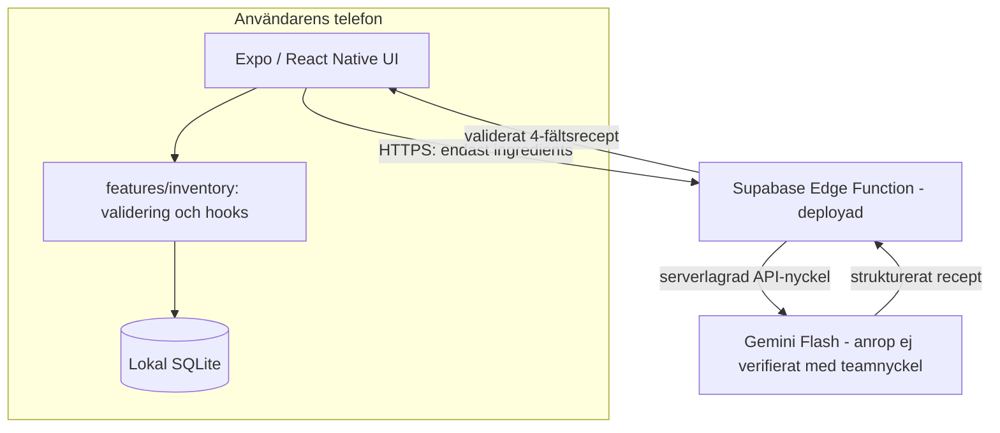

# I'm Hungry!

**Från råvaror till middag.** I'm Hungry! är en mobilapp som ska hjälpa hemmakockar att hålla koll på vad de har hemma och få AI-genererade receptförslag utifrån tillgängliga råvaror och mängder.

Projektet byggs av **BnL Studios** inom en Scrum-kurs. Det är under utveckling, inte en färdig app.

> **Aktuellt läge (2026-11-23):** Appen är en React Native-app med Expo SDK 58, TypeScript och Expo Router. Matförrådet lagras **lokalt på telefonen** med **SQLite och Drizzle ORM** och kan visas, läggas till, ändras och tas bort. Home-fliken har knappen **Generera recept** och visar receptet på samma skärm. Receptflödet använder en **deployad Supabase Edge Function** och ett kontrakt som delas mellan mobil och server i `shared/recipe-contract.ts`. CI är grön (tre checks). **Ett riktigt Gemini-anrop med teamets nyckel är ännu inte verifierat**, och funktionen saknar auth/rate limiting (#138). Supabase används inte som matförrådsdatabas.

## Mål och MVP

Målgrupp: studenter och andra som ofta har råvaror hemma men svårt att bestämma vad de kan laga med just de mängderna.

| Ingår i MVP:n | Hur det ska fungera | Status (2026-11-23) |
|---|---|---|
| Matförråd | Visa, lägga till, korrigera och ta bort råvaror med mängd och enhet. | Implementerat (US-01–US-04). Skalor räknas om till basenheterna g/ml/st. |
| Lokal lagring | Inventariet finns kvar efter omstart och kan hanteras utan internet. | Implementerat med Expo SQLite + Drizzle. |
| Ett receptförslag | Skicka en begäran till Edge Function och visa ett AI-genererat recept utifrån råvarorna som finns. | Implementerat (#140, #141, #142): Home skickar endast `ingredients` till den hostade funktionen och validerar svaret mot snapshot och aktuellt saldo. Riktigt AI-anrop ej verifierat. |
| Resultat och fel | Visa recepttitel, tid, ingredienser, mängder och steg, eller ett begripligt felmeddelande. | Implementerat på Home: titel, tid, ingredienser med mängder och numrerade steg samt laddnings-, fel- och tom-lägen. |

Utanför MVP:n: mat-humör, val av kök, användarkonton, molnsynkronisering, favoriter, recepthistorik, automatiska avdrag ur matförrådet, avancerade preferenser, inköpslistor och streckkodsskanning. **Inventariet fungerar offline; receptgenerering kräver internet.** Lokal data synkroniseras inte mellan enheter och kan förloras vid avinstallation.

Se [MVP](docs/mvp.md), [Product Backlog](docs/USER_STORIES.md), [sprint 1](docs/sprintar/sprint-1/planning.md), [sprint 2](docs/sprintar/sprint-2/planning.md) och [AI-integrationsdesignen](docs/ai-integration.md).

## Teknik och arkitektur

| Del | Val | Status |
|---|---|---|
| Mobilapp | React Native, Expo SDK 58, TypeScript och Expo Router | Implementerad i `mobile/` |
| Navigation | Två flikar: Home (receptgenerator + receptvy) och Råvaror; `add-ingredient` och `edit-ingredient` som modaler | Implementerad |
| Lokal databas | Expo SQLite | Implementerad |
| ORM och migrationer | Drizzle ORM + Drizzle Kit | Implementerade; två migrationer |
| Matförrådets UI | Lista från SQLite, lägga till/ändra/ta bort, skalor, validering och fel/empty-state | Implementerat (PR #122 + sprint 2) |
| Recept-gateway | Supabase Edge Functions (Deno/TypeScript); [API-kontrakt v1](docs/ai-integration.md) med endast ingredienslista in och fyra receptfält ut | Implementerad och deployad (#140, #142); kontraktet ligger i `shared/recipe-contract.ts` |
| AI-tjänst | Gemini Flash; designen föreskriver `gemini-3.8-flash`, koden defaultar till `gemini-3.5-flash-lite` via `GEMINI_MODEL` | Edge Function anropar Gemini med serverhemlighet. Sätt `GEMINI_MODEL=gemini-3.8-flash` eller uppdatera designen; nyckel/konto ännu inte verifierat |
| Test | Vitest: validering, skalor, enheter, migrationer och receptklienten | 5 testfiler, 31 tester |
| CI | GitHub Actions: mobilapp, Edge Function och Supabase Preview | Gröna på `b6e14b6`: `Mobile (Node 22)`, `Recipe Edge Function`, `Supabase Preview` |
| Process | Scrum, trunk-based development, granskade PR:er, squash merge | Dokumenterat |



Hela kedjan är implementerad och deployad. Det som återstår är verifiering med teamets riktiga Gemini-nyckel och ett medvetet modellval.

**Viktig säkerhetsgräns:** API-nyckeln ligger bara som hemlighet i Edge Function, aldrig i appen. Funktionens indata och AI-svar valideras. Funktionen är i dagsläget publik utan användarautentisering eller rate limiting (#138 är öppen); begränsa missbruk och kostnader innan bred publicering. Klienten kontrollerar receptets mängder mot sitt lokala inventarie; funktionens begäran är inte bevis för vad som faktiskt är lagrat på telefonen.

Läs [arkitekturen och dataintegritet](docs/arkitektur.md), [databasschemat](docs/databasschema.md) och [beslutsloggen](docs/beslutslogg.md).

## Kom igång

**Krav:** Git, Node.js 22 eller senare och npm samt simulator/emulator eller mobil med stöd för Expo. Projektet har en `package-lock.json`, så använd `npm ci` för reproducerbar installation. Migrationstestet använder `node:sqlite`, som kräver Node 22+.

```bash
git clone https://github.com/BnL-Studios/im-hungry.git
cd im-hungry/mobile
npm ci
npx expo start
```

Välj i Expo-terminalen om du vill köra i simulator, emulator eller på en telefon. Beroende på vilka native-moduler som tillkommer kan en **development build** behövas. Se [Expo-dokumentationen](https://docs.expo.dev/get-started/start-developing/).

## Testning och CI

Kör från `mobile/`:

```bash
npx tsc --noEmit       # typkontroll
npm test               # Vitest: validering, enheter och migrationer
npm run lint           # ESLint via expo lint
npx expo-doctor        # kontrollera beroenden och konfiguration
```

Testfilerna ligger i `mobile/src/features/`:

- `inventory/validation.test.ts` testar inmatningsreglerna, decimaler vid redigering och avrundning (300 mg → 0,3 g).
- `inventory/scales.test.ts` testar skalornas omvandling till basenheter och flyttalsavrundning.
- `inventory/units.test.ts` testar enheter och formatering.
- `inventory/migrations.test.ts` kör de riktiga SQL-migrationerna mot en temporär SQLite-databas och kontrollerar att `CHECK`-begränsningarna stoppar ogiltiga rader.
- `recipes/generate.test.ts` testar receptklientens anrop, endpoint-validering och felhantering.

[GitHub Actions-CI](.github/workflows/ci.yml) kör vid PR och push till `main` tre jobs: `Mobile (Node 22)` (installation, Expo-konfiguration, lint, typkontroll och Vitest), `Recipe Edge Function` (`deno test`) och `Supabase Preview`.

**Branch protection:** kontrollerna heter **Mobile (Node 22)**, **Recipe Edge Function** och **Supabase Preview**. Om branch protection fortfarande kräver den gamla kontrollen **Backend (Java 21)** måste en GitHub-administratör byta till de nya kontrollerna. Detta sker inte automatiskt.

[GitHub Actions](https://github.com/BnL-Studios/im-hungry/actions) · [Git-arbetsflöde](docs/git-workflow.md)

## Aktuellt läge

Läge 2026-11-23 (efter sprint 2, `main` = `b6e14b6`):

- Flikarna Home och Råvaror; `add-ingredient` och `edit-ingredient` öppnas som modaler.
- Råvarulistan läser från lokal SQLite via Drizzle och `useLiveQuery`; lägga till, ändra mängd och ta bort med bekräftelse fungerar.
- Två Drizzle-migrationer med `CHECK`-begränsningar för positiv mängd och tillåtna enheter.
- Home har **Generera recept** och visar titel, tid, ingrediensmängder och steg i samma vy: snapshot → Edge Function → validering mot nuvarande saldo. Tomt lager, nätverksfel och timeout visas som svenska meddelanden. Inget skrivs tillbaka till förrådet.
- `shared/recipe-contract.ts` används av både mobilapp och Edge Function; 5 Vitest-testfiler (31 tester) och 3 gröna CI-jobb.

Återstår innan receptflödet kan kallas verifierat:

- Ett riktigt Gemini-anrop med teamets nyckel och bekräftad gratiskvot. Kontrollera att serverhemligheten har det namn koden läser (`GEMINI_API`) och sätt `GEMINI_MODEL` enligt det dokumenterade modellvalet.
- Auth/rate limiting (#138) innan endpointen exponeras bredare.
- Uppdatera boarden: #22, #23, #24 och #129 är öppna trots att koden finns på `main`. Mat-humör (US-06) skjuts upp till efter MVP.

**Legacy:** Spring Boot-koden är borttagen. Ingen Java-server eller molndatabas behövs för matförrådet i målarkitekturen.

## Projektstruktur

```text
im-hungry/
├── mobile/                          # Expo-mobilapp
│   ├── app.json
│   ├── package.json
│   ├── drizzle/                     # Genererade SQL-migrationer + metadata
│   ├── src/
│   │   ├── app/                     # Routes (Expo Router)
│   │   │   ├── _layout.tsx          # Rot-Stack + DatabaseProvider
│   │   │   ├── add-ingredient.tsx   # Modal route
│   │   │   ├── edit-ingredient.tsx  # Modal route
│   │   │   └── (tabs)/
│   │   │       ├── _layout.tsx      # Home + Råvaror
│   │   │       ├── index.tsx        # Home: generera recept + receptvy
│   │   │       └── ingredients/
│   │   │           └── index.tsx    # Tunn route till IngredientsScreen
│   │   ├── screens/                 # Skärmkomponenter
│   │   │   ├── IngredientsScreen.tsx
│   │   │   ├── AddIngredientScreen.tsx
│   │   │   └── EditIngredientScreen.tsx
│   │   ├── features/inventory/      # Enheter, skalor, validering, repository + tester
│   │   ├── features/recipes/        # Receptklient + tester
│   │   └── db/                      # Drizzle-schema, client, provider
│   └── ...
├── shared/recipe-contract.ts        # API-kontrakt v1, delat med Edge Function
├── supabase/functions/generate-recipe/  # Deno: index.ts, core.ts, tester
├── docs/
│   ├── arkitektur.md                # Lokal SQLite + implementerad Edge Function
│   ├── databasschema.md             # Databasschema (SQLite)
│   ├── databasschema.dbml           # Redigerbar DBML
│   ├── mvp.md
│   ├── USER_STORIES.md
│   ├── beslutslogg.md
│   ├── definition-of-done.md
│   ├── git-workflow.md
│   ├── gruppkontrakt.md
│   ├── sprintar/
│   └── reflektioner/
├── .github/
│   ├── workflows/ci.yml
│   ├── ISSUE_TEMPLATE/
│   └── pull_request_template.md
└── README.md
```

**Var kod hamnar:** `mobile/src/app/` innehåller endast routes; varje fil där blir en skärm. `mobile/src/screens/` har skärmkomponenter, `mobile/src/features/` domän- och datalager, `mobile/src/db/` Drizzle-schema och databasprovider, och `mobile/drizzle/` de genererade migrationerna. `shared/recipe-contract.ts` delas av mobil och server. `supabase/functions/generate-recipe/` innehåller den deployade Edge Functionen (`index.ts`, `core.ts`), lokala demo-/testhjälpare och Deno-tester.

## Team och arbetsflöde

| Namn | GitHub |
|---|---|
| Benjamin Simmons | [@SimmoM8](https://github.com/SimmoM8) |
| Leo Spenner | [@spennerr](https://github.com/spennerr) |

Vi använder kortlivade branches från `main`, pull requests, minst en annan persons godkännande, och **Squash and merge** som standard. Enligt [gruppkontraktet](docs/gruppkontrakt.md) granskar vi PR:er inom 24 timmar och mergar inte våra egna PR:er.

[GitHub Project-board](https://github.com/orgs/BnL-Studios/projects/1) · [Issues](https://github.com/BnL-Studios/im-hungry/issues) · [Pull requests](https://github.com/BnL-Studios/im-hungry/pulls)

## Dokumentation

| Dokument | Syfte |
|---|---|
| [MVP](docs/mvp.md) | Omfattning och avgränsningar |
| [Product Backlog](docs/USER_STORIES.md) | User stories och acceptanskriterier |
| [Arkitektur](docs/arkitektur.md) | Ansvar, dataflöden, AI-gateway och säkerhet |
| [AI-integrationsdesign](docs/ai-integration.md) | Vald modell, gratisnivå, enkel ingredients-request, fyra receptfält, validering och status för #125/#127 |
| [Databasschema](docs/databasschema.md) · [DBML](docs/databasschema.dbml) | Lokal SQLite-modell |
| [Beslutslogg](docs/beslutslogg.md) | Tidigare och gällande teknikbeslut |
| [Git-arbetsflöde](docs/git-workflow.md) | Branches, PR, CI och squash merge |
| [Definition of Done](docs/definition-of-done.md) | Kvalitetskrav per story |
| [Gruppkontrakt](docs/gruppkontrakt.md) | Teamregler |
| [Sprintdokumentation](docs/sprintar/) | Planning, standup, review, retro |
| [Individuella reflektioner](docs/reflektioner/) | Kursreflektioner |

**Senast uppdaterad:** 2026-11-23 (receptflöde implementerat och deployat; riktigt AI-anrop och modellval att verifiera).
