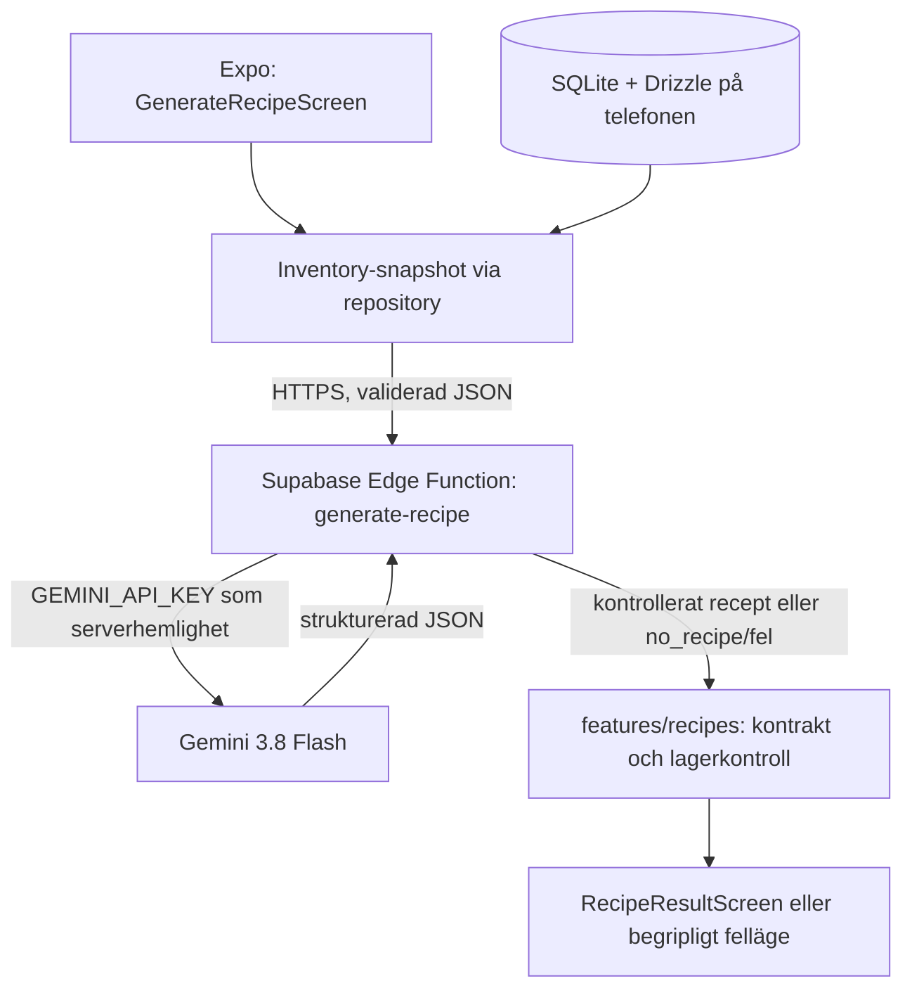

# AI-integration — beslut och kontrakt (sprint 2)

**Beslutad design:** 2026-11-19 · **Status:** Design för #125 klar för PR-granskning; **ingen AI-funktion är implementerad eller driftad ännu**. API-nyckel, verklig projektkvot och lyckat API-anrop återstår inom #127/#128.

Relaterade kort: [#125](https://github.com/BnL-Studios/im-hungry/issues/125) (design), [#127](https://github.com/BnL-Studios/im-hungry/issues/127) (modell och gratis API-åtkomst), [#128](https://github.com/BnL-Studios/im-hungry/issues/128) (integration), [#126](https://github.com/BnL-Studios/im-hungry/issues/126) (generera-sida), [#129](https://github.com/BnL-Studios/im-hungry/issues/129) (receptvy), [#22](https://github.com/BnL-Studios/im-hungry/issues/22) (US-05), [#23](https://github.com/BnL-Studios/im-hungry/issues/23) (US-68), [#24](https://github.com/BnL-Studios/im-hungry/issues/24) (US-67).

## 1. Val av modell

- **Primär modell:** Google Gemini 3.8 Flash, exakt API-ID `gemini-3.8-flash` (stabil modell).
- **Reserv för utvärdering:** Gemini 3.5 Flash-Lite, `gemini-3.5-flash-lite`. Byte sker medvetet efter att samma kontrakttester har körts; ingen tyst automatisk fallback i MVP:n.
- **Motivering:** båda listas med kostnadsfri text-in- och utdata på Gemini API:s Free Tier. 3.8 Flash stöder strukturerad JSON och ger mer utrymme för receptkvalitet och att följa mängdkrav. Flash-Lite kan bli alternativ om kapacitet eller svarstid gör det motiverat.
- **Inte bekräftat för vårt konto:** att nyckeln har tillgång till `gemini-3.8-flash`, vilka RPM/TPM/RPD-gränser som faktiskt gäller och om konto-/åldersverifiering krävs. Gratisnivå betyder inte obegränsade anrop; kontrollera i **vårt** AI Studio-projekt.
- **Kostnad:** undvik att aktivera fakturering för att kringgå gratiskvoten utan ett nytt gemensamt beslut. Hantera 429 och slut på kvot som fel. Sätt inga fasta kvotsiffror i kod eller dokument, de kan ändras.
- **Dataskydd:** Gemini Free Tier kan använda inskickat innehåll för produktförbättring. Skicka enbart minsta nödvändiga inventariedata, aldrig kontouppgifter, identifierare för enhet eller hemligheter. Informera användaren före offentlig användning.

Verifierat 2026-11-19 i [Gemini 3.8 Flash-modellkort](https://aistudio.google.com/docs/models/gemini-3.8-flash), [Flash-Lite-modellkort](https://aistudio.google.com/docs/models/gemini-3.5-flash-lite), [API-priser](https://aistudio.google.com/docs/pricing), [projektspecifika gränser](https://aistudio.google.com/docs/rate-limits) och [villkor](https://ai.google.dev/gemini-api/terms).

## 2. Arkitektur och ansvar



- **Mobilen:** behåller all inventariedata lokalt i SQLite/Drizzle, tar en snapshot när användaren begär ett recept, skickar endast tillåtna fält och kontrollerar svaret mot snapshoten samt aktuell lagerstatus innan det markeras som tillagningsbart. Inga automatiska lageravdrag.
- **Edge Function:** Deno/TypeScript i `supabase/functions/generate-recipe/index.ts`; validerar request, begränsar storlek och anrop, skickar prompt + JSON-schema till Gemini, verifierar resultat och mappar fel till stabilt API-kontrakt. Den har **ingen** direkt åtkomst till telefonens SQLite.
- **AI-leverantören:** föreslår ett recept inom angiven lista; den får inte bestämma vilka ingredienser som faktiskt är tillgängliga.
- **Ingen extra databas eller Spring Boot-server** krävs för MVP:n. En separat serverlagrad begränsare för missbruk kan behövas innan publik driftsättning.
- **Mappindelning:** `mobile/src/app/` har tunna routes; `mobile/src/screens/` har skärmar; `mobile/src/features/recipes/` innehåller API-klient, typer, domänkontroller och tester. `supabase/functions/generate-recipe/` är gränsen till leverantören.

## 3. API-kontrakt v1

**Endpoint:** `POST /functions/v1/generate-recipe` med `Content-Type: application/json`. Klienten anropar Supabase-projektets funktion via HTTPS. Autentisering och missbruksskydd behöver lösas innan internetpublik drift (se `5`).

**Request:** endast följande fält accepteras. `mood` är förberett för US-06, men kan skickas som `surprise` tills valet finns i UI. Databasens basenheter är `g`, `ml` och `qty` (UI visar `st`, men API:t använder `qty`).

```json
{
  "ingredients": [
    { "id": 1, "name": "Ris", "quantity": 500, "unit": "g" },
    { "id": 2, "name": "Ägg", "quantity": 4, "unit": "qty" },
    { "id": 3, "name": "Lök", "quantity": 2, "unit": "qty" }
  ],
  "mood": "surprise"
}
```

**Regler för request:** `ingredients` innehåller 1–50 unika positiva heltals-ID:n, namn på 1–80 tecken, en positiv ändlig mängd och en av ovanstående enheter. `mood` tillhör `surprise`, `comfort` eller `quick`. Avvisa okända fält, duplicerade ID:n, icke-finit tal och för stora payloads. Enhet `qty` bör vara heltal för diskreta varor om det kan säkerställas från matförrådet; nya regler får inte i tysthet ändra befintliga SQLite-värden.

**Framgång (HTTP 200):** exakt ett recept; ingredienser refererar till **ID:n från requesten**, inte fria modellnamn. Klienten kan slå upp de korrekta namnen från sin snapshot.

```json
{
  "status": "ok",
  "recipe": {
    "title": "Stekt ris med ägg och lök",
    "durationMinutes": 20,
    "ingredients": [
      { "inventoryId": 1, "quantity": 200, "unit": "g" },
      { "inventoryId": 2, "quantity": 2, "unit": "qty" },
      { "inventoryId": 3, "quantity": 1, "unit": "qty" }
    ],
    "steps": [
      "Koka riset enligt anvisningarna.",
      "Stek löken och tillsätt riset.",
      "Rör ner äggen och tillaga tills de är genomstekta."
    ]
  }
}
```

**Inget möjligt recept (HTTP 200):**

```json
{ "status": "no_recipe", "message": "Inget recept kan göras med dessa mängder." }
```

**Tekniskt/valideringsfel (HTTP 4xx/5xx):**

```json
{ "error": { "code": "RATE_LIMITED", "message": "För många förfrågningar. Försök igen senare." } }
```

Dokumenterade felkoder för v1: `INVALID_REQUEST` (400), `RATE_LIMITED` (429), `MODEL_UNAVAILABLE` (502/503), `INVALID_RECIPE` (502), `TIMEOUT` (504) och `INTERNAL_ERROR` (500). Nätverksfel kan uppstå i appen utan HTTP-svar. API:t ska inte skicka läckta felmeddelanden, prompts, tokens eller hemligheter till användaren.

## 4. Receptregler och validering

1. Prompten kräver att **endast inskickade råvaror** används; inte ens salt, olja, vatten eller kryddor antas finnas om de inte finns i snapshoten. Inget köpbehov maskeras som tillgängligt.
2. Använd Geminis **structured output / JSON Schema**, men behandla alla modellfält som otillförlitliga. Validera fullständigt i Edge Function och igen i klienten. Strukturerad JSON garanterar inte receptets faktiska genomförbarhet.
3. `title` ska vara en icke-tom text, `durationMinutes` ett rimligt positivt heltal, `steps` en lista med användbara icke-tomma steg och `ingredients` en icke-tom lista med positiva ändliga mängder och giltiga enheter.
4. Varje `inventoryId` måste finnas i ursprunglig snapshot. Enheten måste matcha exakt, eller vara en uttryckligen implementerad, testad enhetsomräkning. Summera eventuellt upprepade receptposter **per ID** innan kvantitetskontrollen; summan får inte överstiga tillgänglig mängd (med en liten dokumenterad tolerans enbart för flyttalsavrundning, inte för brist).
5. Jämför också mot aktuellt inventarium om användaren ändrade något medan förfrågan kördes. Ett recept som inte längre går att laga markeras inte som tillgängligt.
6. Vid okänt ID, orimlig mängd, extra ingrediens, tomma steg eller annan avvikelse: **visa inte receptet som tillagningsbart**. Svara med `no_recipe` eller `INVALID_RECIPE` i stället för att i smyg lägga till/ta bort råvaror.
7. Generering är **read-only** mot lagret: ingen infogning, uppdatering eller borttagning av råvaror. Receptet sparas inte permanent i MVP:n.

[Google: Structured outputs](https://aistudio.google.com/docs/structured-output).

## 5. API-nyckel, säkerhet och åtkomst

- Generera en projekt-API-nyckel i [Google AI Studio](https://aistudio.google.com/api-keys). Testa sedan **ett verkligt** API-anrop med `gemini-3.8-flash` och kontrollera att projektet är på rätt gratiskvot. Detta är **inte ännu utfört** i repo/dokumentation.
- Spara den privata nyckeln som `GEMINI_API_KEY` bland **Supabase Edge Function Secrets**. För lokal utveckling används `supabase/functions/.env` (ignoreras av Git); vid drift sätts secret i Supabase Dashboard/CLI. Lägg **aldrig** privat nyckel i Git eller `EXPO_PUBLIC_*`. Modell-ID kan lagras som icke-hemlig `GEMINI_MODEL` på servern.
- En app utan inloggning kan inte säkra en publik funktion genom att endast skicka en publikt inbyggd nyckel. `verify_jwt = false` är **inte** ett missbruksskydd. Kräv före publik driftsättning konkreta request-begränsningar och serverbaserad rate limiting/kvot, övervakning samt ett medvetet åtkomstbeslut.
- För sprintdemo: börja med en lokal eller åtkomstbegränsad testmiljö; exponera inte en oskyddad kostnadsdrivande endpoint. Logga aldrig fulla skafferi-payloads eller API-nycklar.
- Se [Supabase Secrets](https://supabase.com/docs/guides/functions/secrets), [Securing Edge Functions](https://supabase.com/docs/guides/functions/auth) och [Rate limiting](https://supabase.com/docs/guides/functions/rate-limiting).

## 6. Implementationsordning och acceptans

- [x] **#125 — Designbeslut:** modell, gränser, ansvar, request/response, fel och valideringsstrategi definierade i dokument (väntar på review/merge).
- [x] **#127 — Modellval:** primär `gemini-3.8-flash`, reserv `gemini-3.5-flash-lite`; båda dokumenterade mot officiella källor.
- [ ] **#127 — Konto:** AI Studio-projekt/nyckel skapad, verklig gratisåtkomst och begränsningar verifierade av teamet; hemligheten säkert konfigurerad.
- [ ] **#128:** Edge Function returnerar ett äkta, schemavaliderat recept och hanterar ogiltig input, 429, timeout och felaktigt AI-svar.
- [ ] **#126:** Mobilen läser SQLite-snapshot, anropar tjänsten och visar laddning/tomt läge/fel.
- [ ] **#129 / US-68:** Receptvy presenterar titel, tid, exakta råvaror/mängder och steg.
- [ ] **US-05 / US-67:** Tests visar att lager inte ändras och att inga saknade eller överstora mängder presenteras som tillgängliga.

**Gräns för #125:** detta dokument är design, inte påstående om fungerande API, konfigurerad prenumeration eller färdigt sprintmål.
