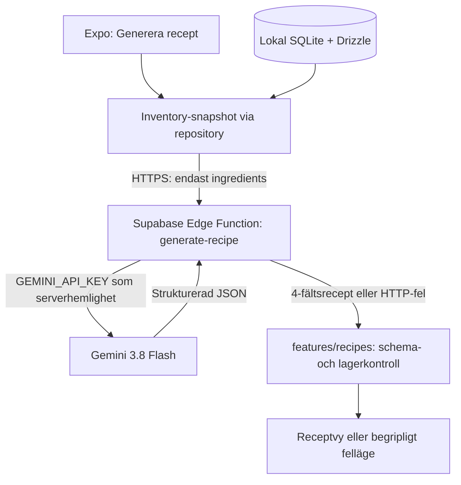

# AI-integration — beslut och kontrakt (sprint 2)

**Beslutad design:** 2026-11-19 · **Status:** Ursprunglig design för #125. Aktuell driftsättning och modell för MVP:n beskrivs under **Publik MVP för #128 och #126**.

Relaterade kort: [#125](https://github.com/BnL-Studios/im-hungry/issues/125) (design), [#127](https://github.com/BnL-Studios/im-hungry/issues/127) (modell och gratis API-åtkomst), [#128](https://github.com/BnL-Studios/im-hungry/issues/128) (integration), [#126](https://github.com/BnL-Studios/im-hungry/issues/126) (generera-sida), [#129](https://github.com/BnL-Studios/im-hungry/issues/129) (receptvy), [#22](https://github.com/BnL-Studios/im-hungry/issues/22) (US-05), [#23](https://github.com/BnL-Studios/im-hungry/issues/23) (US-68), [#24](https://github.com/BnL-Studios/im-hungry/issues/24) (US-67).

## 1. Val av modell

- **Primär modell:** Google Gemini 3.8 Flash, exakt API-ID `gemini-3.8-flash` (stabil modell).
- **Reserv för utvärdering:** Gemini 3.5 Flash-Lite, `gemini-3.5-flash-lite`. Byte sker medvetet efter att samma kontrakttester har körts; ingen tyst automatisk fallback i MVP:n.
- **Motivering:** båda listas med kostnadsfri text-in- och utdata på Gemini API:s Free Tier. 3.8 Flash stöder strukturerad JSON och ger mer utrymme för receptkvalitet och att följa mängdkrav. Flash-Lite kan bli alternativ om kapacitet eller svarstid gör det motiverat.
- **Inte bekräftat för vårt konto:** att nyckeln har tillgång till `gemini-3.8-flash`, vilka RPM/TPM/RPD-gränser som faktiskt gäller och om konto-/åldersverifiering krävs. Gratisnivå betyder inte obegränsade anrop; kontrollera i **vårt** AI Studio-projekt.
- **Kostnad:** undvik att aktivera fakturering för att kringgå gratiskvoten utan ett nytt gemensamt beslut. Hantera 429 och slut på kvot som fel. Sätt inga fasta kvotsiffror i kod eller dokument, de kan ändras.
- **Dataskydd:** Gemini Free Tier kan använda inskickat innehåll för produktförbättring. Skicka enbart minsta nödvändiga inventariedata, aldrig kontouppgifter, identifierare för enhet eller hemligheter. Informera användaren före offentlig användning.

Verifierat 2026-11-19 i [Gemini 3.8 Flash-modellkort](https://aistudio.google.com/docs/models/gemini-3.8-flash), [Flash-Lite-modellkort](https://aistudio.google.com/docs/models/gemini-3.5-flash-lite), [API-priser](https://aistudio.google.com/docs/pricing), [projektspecifika gränser](https://aistudio.google.com/docs/rate-limits) och [villkor](https://ai.google.dev/gemini-api/terms).

## 2. Arkitektur och ansvar

`MVP-beslut 2026-11-19:` Receptgenerering har **ett enda indatafält** (`ingredients`) och svarar med **exakt fyra fält** vid framgång: `title`, `ingredients`, `steps`, `estimatedCookingTime`. Ingen `mood`, val av kök, portionsstorlek, språkparameter, användarprofil eller annat ingår i request v1. Mat-humör (US-06) skjuts upp till efter denna MVP.



- **Mobilen** äger inventariet lokalt och skickar en ögonblicksbild endast när användaren trycker på Generera. Den validerar svaret mot denna snapshot och aktuellt lager innan receptet markeras som tillagningsbart. Genereringen förändrar aldrig inventariet.
- **Edge Function** i `supabase/functions/generate-recipe/index.ts` är ett litet Deno/TypeScript-lager som validerar request och AI-svar, använder serverhemligheten och returnerar kontraktet nedan eller ett tydligt HTTP-fel. Den kan inte läsa mobilens SQLite direkt.
- **Gemini** skapar ett recept utifrån enbart listade råvaror; appen och Edge Function är ansvariga för tillgänglighetskontrollen.
- Ingen separat Java/Node-server eller molnlagring av skafferiet behövs. Mobilens routes hålls i `src/app/`, skärmar i `src/screens/` och recept-API/validering i `src/features/recipes/`.

## 3. API-kontrakt v1 — minsta möjliga

**Endpoint:** `POST /functions/v1/generate-recipe` med `Content-Type: application/json`. Endpointens åtkomstskydd beskrivs i avsnitt 5.

### Request (enda toppnivåfältet: ingredients)

```json
{
  "ingredients": [
    { "id": 1, "name": "Kokt ris", "quantity": 500, "unit": "g" },
    { "id": 2, "name": "Ägg", "quantity": 4, "unit": "qty" },
    { "id": 3, "name": "Lök", "quantity": 2, "unit": "qty" }
  ]
}
```

Ingrediensposterna motsvarar befintliga SQLite-fält: positivt heltals-`id`, `name` (1–80 tecken), positivt ändligt `quantity` och `unit` (`g`, `ml` eller `qty`; i användargränssnittet visas `qty` som `st`). Begäran tillåter exempelvis 1–50 unika ingredienser. Avvisa okända toppnivåfält, dubblett-ID, otillåtna enheter och för stora requests. Den *enda* begäran som skickas till AI-flödet är denna ingredienslista — ingen `mood` eller annan preferens.

### Lyckat svar (HTTP 200: exakt fyra toppnivåfält)

```json
{
  "title": "Stekt kokt ris med ägg och lök",
  "ingredients": [
    { "id": 1, "quantity": 200, "unit": "g" },
    { "id": 2, "quantity": 2, "unit": "qty" },
    { "id": 3, "quantity": 1, "unit": "qty" }
  ],
  "steps": [
    "Värm det redan kokta riset i en stekpanna.",
    "Tillsätt finhackad lök och stek under omrörning.",
    "Rör ner äggen och tillaga tills de är genomstekta."
  ],
  "estimatedCookingTime": 20
}
```

- `title`: receptets namn, icke-tom sträng.
- `ingredients`: använda råvaror med `id` från requesten, positiv `quantity` och samma `unit` som i inventariet. Namnet hämtas från snapshoten i appen — AI behöver inte skapa det en gång till. Dubbletter summeras per ID innan kontroll.
- `steps`: en icke-tom lista med tydliga, ordnade tillagningssteg.
- `estimatedCookingTime`: uppskattad **total tillagningstid i minuter**, positivt heltal.

**Ingen `status`, `recipe`-wrapper, metadata eller extra inställningar i ett lyckat svar.** Fältnamnen är kontraktets exakta stavning och ska användas likadant i Supabase, mobilapp, tester och receptskärm.

### Fel (separat från lyckat recept)

När inget rimligt recept kan genereras eller anropet misslyckas returneras ett HTTP-fel; detta är **inte** ett recept med fyra tomma fält.

```json
{
  "error": {
    "code": "NO_RECIPE",
    "message": "Inget recept kan göras med dessa råvaror och mängder."
  }
}
```

- `NO_RECIPE` (422): tillgängligt lager räcker inte till ett giltigt recept; visa begripligt meddelande.
- `INVALID_REQUEST` (400): tom/ogiltig ingredienslista eller felaktig JSON.
- `RATE_LIMITED` (429): API-kvot eller rate limit nådd.
- `MODEL_UNAVAILABLE` (502/503), `INVALID_RECIPE` (502), `TIMEOUT` (504) och `INTERNAL_ERROR` (500): tekniska fel utan att exponera hemligheter eller leverantörens råa internfel.
- Nätverksfel kan uppstå utan HTTP-svar och ska visas tydligt i appen. Inventariet ska fortfarande fungera offline.

## 4. Receptregler och validering

1. Prompten kräver att **enbart inskickade råvaror** används; även salt, olja, vatten och kryddor måste finnas i listan om receptet kräver dem. Ingen implicit inköpslista.
2. Begär Geminis **structured output / JSON Schema** för de fyra fälten ovan. Validera ändå resultatet i Edge Function och mobilen: modellen är inte en källa till sanning om tillgänglighet.
3. Varje `ingredients[].id` måste finnas i requestens snapshot. Enheten måste matcha och **summan** av föreslagna mängder per ID får inte överstiga tillgänglig mängd; eventuella toleranser får endast avse dokumenterad flyttalsavrundning, aldrig faktisk brist.
4. Försök inte rätta modellens recept genom att automatiskt lägga till eller öka lagerrader. Avvisa ogiltigt resultat med `INVALID_RECIPE` eller `NO_RECIPE` och visa inget som tillagningsbart.
5. Om inventariet ändras medan anropet körs ska mobilen kontrollera mot nuvarande saldo innan receptet visas som tillgängligt.
6. Receptbegäran är **read-only**: inga råvaror läggs till, ändras eller dras av; resultatet sparas inte permanent i MVP:n.

[Google: Structured outputs](https://aistudio.google.com/docs/structured-output).

## 5. API-nyckel, säkerhet och åtkomst

- Generera en projekt-API-nyckel i [Google AI Studio](https://aistudio.google.com/api-keys). Testa sedan **ett verkligt** API-anrop med `gemini-3.8-flash` och kontrollera att projektet är på rätt gratiskvot. Detta är **inte ännu utfört** i repo/dokumentation.
- Spara den privata nyckeln som `GEMINI_API_KEY` bland **Supabase Edge Function Secrets**. För lokal utveckling används `supabase/functions/.env` (ignoreras av Git); vid drift sätts secret i Supabase Dashboard/CLI. Lägg **aldrig** privat nyckel i Git eller `EXPO_PUBLIC_*`. Modell-ID kan lagras som icke-hemlig `GEMINI_MODEL` på servern.
- En app utan inloggning kan inte säkra en publik funktion genom att endast skicka en publikt inbyggd nyckel. `verify_jwt = false` är **inte** ett missbruksskydd. Kräv före publik driftsättning konkreta request-begränsningar och serverbaserad rate limiting/kvot, övervakning samt ett medvetet åtkomstbeslut.
- För sprintdemo: börja med en lokal eller åtkomstbegränsad testmiljö; exponera inte en oskyddad kostnadsdrivande endpoint. Logga aldrig fulla skafferi-payloads eller API-nycklar.
- Se [Supabase Secrets](https://supabase.com/docs/guides/functions/secrets), [Securing Edge Functions](https://supabase.com/docs/guides/functions/auth) och [Rate limiting](https://supabase.com/docs/guides/functions/examples/rate-limiting).

## 6. Implementationsordning och acceptans

- [x] **#125 — Designbeslut:** modell, gränser, ansvar, request/response, fel och valideringsstrategi definierade i dokument (väntar på review/merge).
- [x] **#127 — Modellval:** primär `gemini-3.8-flash`, reserv `gemini-3.5-flash-lite`; båda dokumenterade mot officiella källor.
- [ ] **#127 — Konto:** AI Studio-projekt/nyckel skapad, verklig gratisåtkomst och begränsningar verifierade av teamet; hemligheten säkert konfigurerad.
- [ ] **#128:** Edge Function returnerar ett äkta, schemavaliderat recept och hanterar ogiltig input, 429, timeout och felaktigt AI-svar.
- [ ] **#126:** Mobilen läser SQLite-snapshot, anropar tjänsten och visar laddning/tomt läge/fel.
- [ ] **#129 / US-68:** Receptvy presenterar titel, tid, exakta råvaror/mängder och steg.
- [ ] **US-05 / US-67:** Tests visar att lager inte ändras och att inga saknade eller överstora mängder presenteras som tillgängliga.

**Gräns för #125:** detta dokument är design, inte påstående om fungerande API, konfigurerad prenumeration eller färdigt sprintmål.

## Publik MVP för #128 och #126

Expo använder projektets HTTPS-endpoint för `generate-recipe` som standard. Home skickar den lokala inventariesnapshoten först efter knapptryckning. För Leos receptvy (#129) innehåller `RecipeResult` det validerade receptet och samma snapshot med råvarunamnen.

MVP-beslutet ersätter driftsättningsvillkoret i avsnitt 5. Funktionen är publik utan JWT-verifiering eller egen rate limiting. Varje anrop kan förbruka projektets Gemini-kvot. Åtkomstskydd och kvotbegränsning följs upp i [#138](https://github.com/BnL-Studios/im-hungry/issues/138).

Sätt `GEMINI_API_KEY` och `GEMINI_MODEL=gemini-3.5-flash-lite` bland projektets Edge Function Secrets. Driftsätt från repots rot:

```sh
supabase functions deploy generate-recipe --remote=wkfmtrdltjwvhhjpgdco --no-verify-jwt --use-api
```

Testa i Expo genom att lägga till råvaror och välja **Home → Generera recept**. Kontrollera namn, mängd, steg och tid mot råvarorna. En tidigare lokal `EXPO_PUBLIC_RECIPE_URL` behöver tas bort för att använda den hostade funktionen. Starta sedan om Expo.
