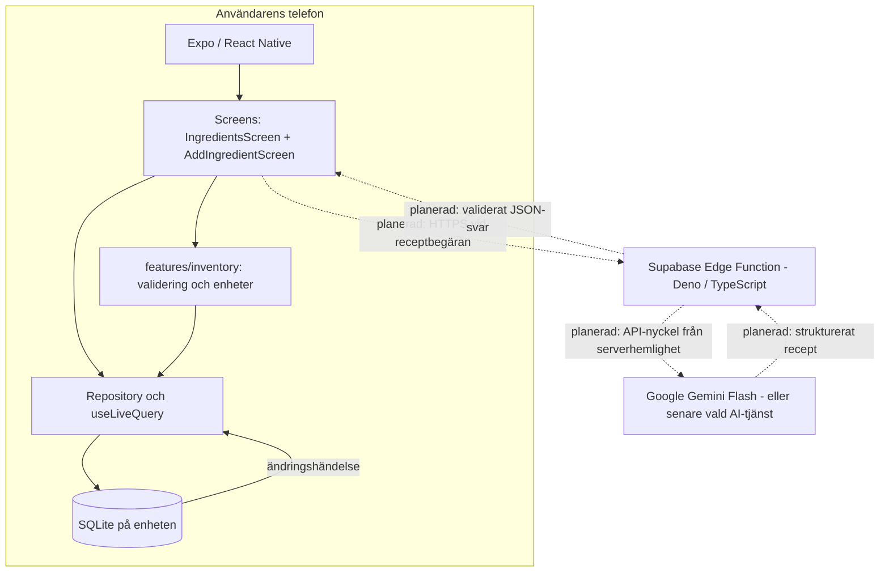

# Arkitektur — lokal databas och planerad AI-gateway

**Status (2026-11-13, sprint 1):** Datalagret och matförrådets första UI är implementerade. Receptflödet, Supabase Edge Function och AI-integrationen återstår. Arbetet med listan och formuläret ligger på branchen `add-ingredient` och väntar på granskning/merge.

## Översikt



Heldragna delar finns i koden idag. Streckade delar är målarkitektur och är **inte** byggda.

**Två olika ansvar:** SQLite lagrar *data på telefonen*. Supabase ska **endast** användas för att köra en Edge Function som säkert anropar AI; ingen Supabase PostgreSQL-databas krävs för MVP:n.

## 1. Matförrådet: helt lokalt

Implementerat i sprint 1:

- Inventariet sparas per appinstallation med `expo-sqlite` i databasen `imhungry.db`.
- Drizzle ORM ligger bakom `features/inventory/repository.ts`. Skärmarna innehåller ingen SQL.
- `IngredientsScreen` läser via `useInventoryItems` (`useLiveQuery`). Listan uppdateras automatiskt när `inventory_items` ändras och visar laddning, tomt läge och fel.
- `AddIngredientScreen` validerar namn, positiv mängd och enhet med `parseIngredientInput`, och sparar med `useAddIngredient`. Formuläret öppnas som modal från fliken **Råvaror**.
- SQLite-begränsningar skyddar lagrade värden även om TypeScript-validering missas: `quantity > 0` och `unit in ('g', 'ml', 'qty')`.
- Drizzle Kit skapar granskade, versionshanterade migrationer som körs vid appstart innan databasfrågor utförs.
- Två migrationer finns: `0000_freezing_rick_jones.sql` skapar tabellen och `0001_woozy_the_order.sql` lägger till `CHECK`-begränsningarna och bevarar befintliga rader.
- Inventariet fungerar utan internet. Det finns **ingen** automatisk säkerhetskopia, kontosynk eller överföring mellan telefoner.

**Ännu inte implementerat:** korrigera mängd (US-03), ta bort råvara (US-04) och mat-humör. Home-fliken är fortfarande en placeholder.

## 2. Receptbegäran: planerad

Detta flöde är **inte byggt** i sprint 1. Så här ska det fungera när det byggs:

1. Användaren väljer mat-humör och trycker på knappen för receptförslag.
2. Mobilappen hämtar ett **ögonblicksutdrag** ur lokal SQLite. Bara nödvändiga råvaror, mängder, enheter och humör skickas över HTTPS.
3. Supabase Edge Function (Deno/TypeScript) validerar indata, begränsar tillåtna fält och rimlig storlek och anropar AI-leverantören med API-nyckel från serverlagrad hemlighet.
4. Funktionen validerar AI-svarets struktur och grundläggande receptbegränsningar. Den skickar tillbaka ett JSON-resultat eller ett tydligt fel (t.ex. timeout, tjänsten otillgänglig, kvot nådd).
5. Appen validerar att föreslagna ingredienser och mängder är möjliga utifrån **den lokala inventarie-snapshot som användes**. Om receptet inte är giltigt visas en begriplig fel-/alternativvy. Ingenting dras automatiskt från lagret.

**Begränsning:** Edge Function har ingen direkt insyn i SQLite och kan därför **inte oberoende verifiera telefonens verkliga saldo**. Den kan validera mot den inskickade listan. Appen ansvarar för kontrollen mot lagret på enheten och eventuell förändring sedan begäran gjordes.

## 3. Säkerhet och missbruksskydd

- **Aldrig:** Lägg en privat Gemini/OpenAI-nyckel i React Native-kod, Git, apppaketet eller `EXPO_PUBLIC_*`.
- **Serverhemligheter:** Lagra AI-nyckeln via Supabases hantering av Edge Function-secrets.
- **Ingen inloggning i MVP:n:** En funktion som går att anropa utan användarautentisering kan utnyttjas av obehöriga. En publik/`verify_jwt = false`-konfiguration är **inte** ett missbruksskydd. Innan funktionen exponeras publikt måste ni bestämma praktiska skydd som rate limiting, kostnadskvoter, övervakning och lämplig anropskontroll. En publik/anon-nyckel i appen är inte hemlig.
- **Indatavalidering:** Begränsa antal råvaror, namn- och textlängder, mängder och tillåtna humör; avvisa oväntade fält och osäkert stora anrop.
- **Svar:** Begär strukturerat JSON från AI och validera mot ett explicit schema. Modellens resultat är opålitligt tills det verifierats.
- **Dataminimering:** Skicka inte identitet, enhets-ID eller andra personuppgifter för receptbegäran när det inte behövs.
- **Offline-fel:** Visa tydligt när AI-funktionen inte kan nås. Matförrådet ska fortsätta fungera.

## 4. Mappstruktur

```text
mobile/
  src/
    app/                       # Expo Router: endast routes
      _layout.tsx              # Rot-Stack + DatabaseProvider
      add-ingredient.tsx       # Modal route
      (tabs)/
        _layout.tsx            # Home + Råvaror
        index.tsx              # Home (placeholder)
        ingredients/index.tsx  # Tunn route
    screens/                   # Skärmkomponenter
      IngredientsScreen.tsx
      AddIngredientScreen.tsx
    features/
      inventory/               # Enheter, validering, repository, tester
      recipes/                 # Planerad: UI, anropsklient, svarskontroll
    db/
      client.ts                # Memoiserad Drizzle-instans (useDatabase)
      provider.tsx             # SQLiteProvider + migrationer vid start
      schema.ts                # Drizzle-schema (sanningskälla)
  drizzle/                     # Genererade SQL-migrationer och metadata
supabase/functions/
  generate-recipe/             # Planerad: Deno/TypeScript, validering + AI-gateway
```

Routes i `src/app/` hålls tunna: de importerar skärmar från `src/screens/` och domänlogik från `src/features/`. `db/` innehåller allt som rör databasen, så skärmar och features slipper SQL. `features/inventory/` har det delade datalagret för matförrådet. `features/recipes/` och `supabase/` skapas när receptflödet startar.

## 5. Teknisk verifiering

**Implementerat i sprint 1:**

- Lista, tomt läge och felvy är implementerade mot lokal SQLite.
- Formuläret för att lägga till en råvara är implementerat med delad validering och sparning.

**Automatiskt verifierat:**

- Ogiltig mängd/enhet stoppas av validering och av SQLite `CHECK`-begränsningar (täcks av `validation.test.ts` och `migrations.test.ts`).
- Migration från tom installation och från föregående databasversion bevarar existerande data (testas av `migrations.test.ts`).
- `npx tsc --noEmit` och `npm run lint` passerar.

**Manuellt att verifiera i samband med review:**

- Att listan uppdateras direkt efter save och att datan finns kvar efter appomstart.
- Att flödet fungerar på både native och webb, inklusive modalens stängning och tangentbord.

**Återstår att verifiera när receptflödet byggs:**

- AI-funktionen klarar ogiltiga JSON-requests, timeout, 429, felaktigt AI-svar och otillgängligt nätverk.
- Inga hemligheter förekommer i mobilappens byggda kod eller Git.
- Receptets ingredienser och mängder kontrolleras mot den lokala inventarie-snapshoten.

## Beslut och externa referenser

- [Beslutsloggen](beslutslogg.md), beslut 06–07.
- [MVP](mvp.md) · [Databasschema](databasschema.md) · [Sprint 1](sprintar/sprint-1/planning.md).
- [Expo SQLite](https://docs.expo.dev/versions/v58.0.0/sdk/sqlite/) · [Drizzle / Expo SQLite](https://orm.drizzle.team/docs/sqlite/connect-expo-sqlite) · [Supabase Edge Functions](https://supabase.com/docs/guides/functions).

**Senast uppdaterad:** 2026-11-13 (sprint 1).
