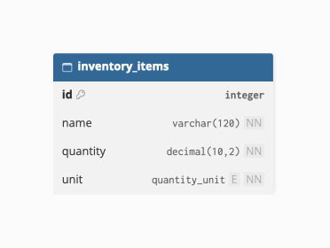

# Databasschema

## Diagram

## Tabeller

| Tabell | Innehåll |
|---|---|
| `inventory_items` | Stores the ingredients currently available in the user's kitchen, including their names, quantities, and measurement units. |

The `inventory_items` table contains the following fields:

| Field | Type | Description |
|---|---|---|
| `id` | INTEGER | Primary key, uniquely identifies each inventory item. |
| `name` | VARCHAR(120) | Name of the ingredient. Required. |
| `quantity` | DECIMAL(10,2) | Available amount. Must be greater than zero. |
| `unit` | ENUM | Measurement unit: `g`, `ml`, or `pcs`. |

The MVP uses a single demonstration inventory without individual user accounts.

Recipes are generated on demand using the current inventory and are not persisted in the MVP.

This schema is an initial draft based on the Must Have user stories. It will be updated as requirements evolve.
