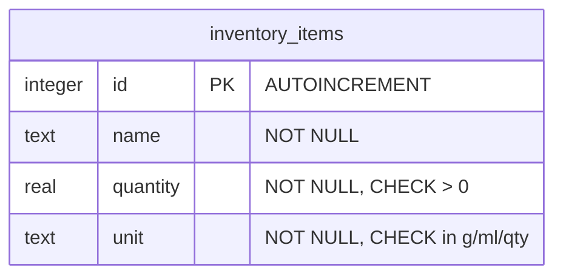

# Databasschema

> **Status (2026-11-13, sprint 1):** Implementerad i `mobile/src/db/schema.ts` med två versionshanterade Drizzle-migrationer i `mobile/drizzle/`. **SQLite finns på telefonen**, inte i Supabase. Matförrådslistan och formuläret för att lägga till en råvara använder tabellen.

## Diagram

## Tabeller

| Tabell | Innehåll |
|---|---|
| `inventory_items` | Lokalt tillgängliga råvaror med namn, mängd och enhet. |

| Fält | SQLite-typ | Regel | Beskrivning |
|---|---|---|---|
| `id` | `INTEGER` | Primärnyckel, `AUTOINCREMENT` | Unikt id per råvara. |
| `name` | `TEXT` | `NOT NULL` | Råvarans namn. Längd och trimning valideras i appen (max 80 tecken). |
| `quantity` | `REAL` | `NOT NULL`, `CHECK (quantity > 0)` | Mängd, t.ex. `500` eller `1.5`. |
| `unit` | `TEXT` | `NOT NULL`, `CHECK (unit IN ('g','ml','qty'))` | `qty` är internt token för styck och visas som `st` i gränssnittet. |

## Begränsningar

- `inventory_items_quantity_positive`: `quantity > 0`.
- `inventory_items_unit_allowed`: `unit in ('g', 'ml', 'qty')`.

Appen validerar dessutom namn (1–80 tecken), positiv mängd och högsta mängd `1 000 000` innan en insert försöker köras. Databasen har ingen längdbegränsning på `name`; den kontrollen ligger i appens validering.

## Migrationer

| Migration | Innehåll |
|---|---|
| `0000_freezing_rick_jones.sql` | Skapar `inventory_items` med `id`, `name`, `quantity` och `unit`. |
| `0001_woozy_the_order.sql` | Bygger om tabellen med `CHECK`-begränsningarna och kopierar befintliga rader innan den gamla tabellen ersätts. |

Migrationerna körs vid appstart av `DatabaseProvider` innan databasfrågor utförs. `migrations.test.ts` kör de riktiga SQL-filerna mot en temporär SQLite-databas och verifierar både giltiga och ogiltiga rader.

## Validering och typer

Drizzle ger TypeScript-typer och genererar SQL-migrationer. `quantity` är `REAL`; valet är preliminärt och kan omprövas om exakt decimalhantering krävs. `qty` är det interna värdet för styck och visas som `st` i appen. Det finns inga tidsstämplar, kategorier eller utgångsdatum i sprint 1.

## Koppling till MVP

Ingen `users`-tabell behövs eftersom varje appinstallation har sitt eget matförråd. Recept genereras vid behov via en planerad **Supabase Edge Function**, men recepten och AI-anropen kräver inga nya SQLite-tabeller i MVP:n. Funktionen ska inte lagra matförrådet i Supabase.

`mobile/src/db/schema.ts` och de versionshanterade migrationerna i `mobile/drizzle/` är den tekniska sanningskällan. Uppdatera diagrammet när modellen ändras.

**Senast uppdaterad:** 2026-11-13 (sprint 1).
