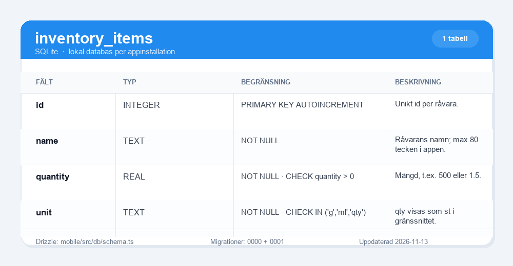

# Databasschema

> **Status:** Implementerad i `mobile/src/db/schema.ts` med två versionshanterade Drizzle-migrationer (`mobile/drizzle/`). **SQLite finns på telefonen**, inte i Supabase.

## Diagram

## Tabeller

| Tabell | Innehåll |
|---|---|
| `inventory_items` | Lokalt tillgängliga råvaror med namn, mängd och enhet. |

| Fält | SQLite-typ | Regel |
|---|---|---|
| `id` | `INTEGER` | Primärnyckel. |
| `name` | `TEXT` | Obligatoriskt råvarunamn. |
| `quantity` | `REAL` | Obligatorisk mängd större än 0. |
| `unit` | `TEXT` | Endast `g`, `ml` eller `quantity`. |

**Validering:** Drizzle ger typer och genererar SQL-migrationer. Utöver det finns två `CHECK`-begränsningar i databasen: `inventory_items_quantity_positive` (`quantity > 0`) och `inventory_items_unit_allowed` (endast `g`, `ml` eller `quantity`). Runtime-validering i appen ska ge begripliga fel innan en insert försöker köras. Modellen kan senare utökas med till exempel tidsstämplar. Valet av `REAL` för mängder är preliminärt och kan omprövas om exakt decimalhantering krävs.

## Koppling till MVP

Ingen `users`-tabell behövs eftersom varje appinstallation har sitt eget matförråd. Recept genereras vid behov via en **Supabase Edge Function**, men recepten och AI-anropen kräver inte några nya SQLite-tabeller i MVP:n. Funktionen lagrar inte matförrådet i Supabase.

`mobile/src/db/schema.ts` och de versionshanterade migrationerna i `mobile/drizzle/` är den tekniska sanningskällan. Uppdatera diagrammet när modellen ändras.
